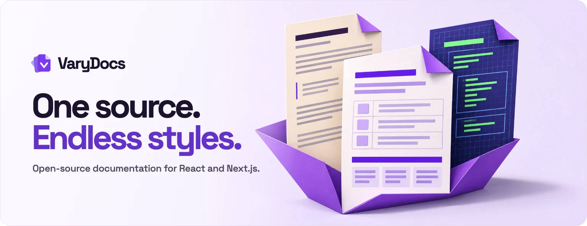
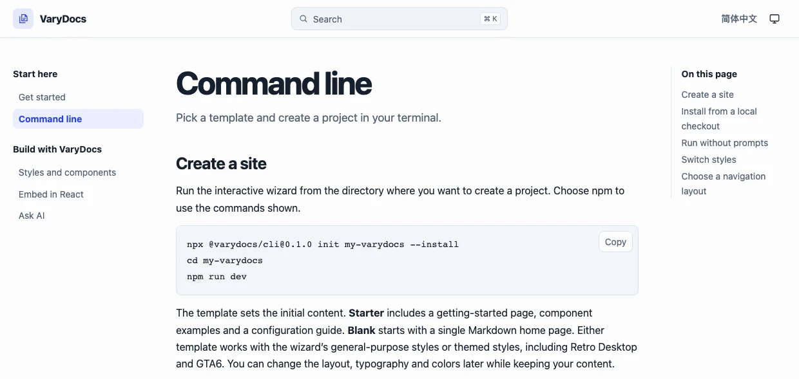
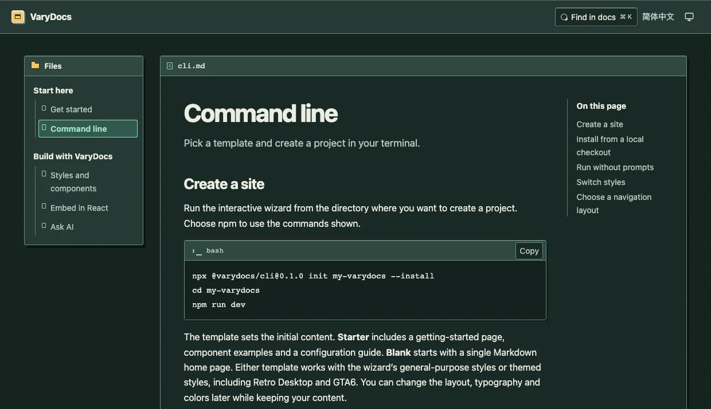
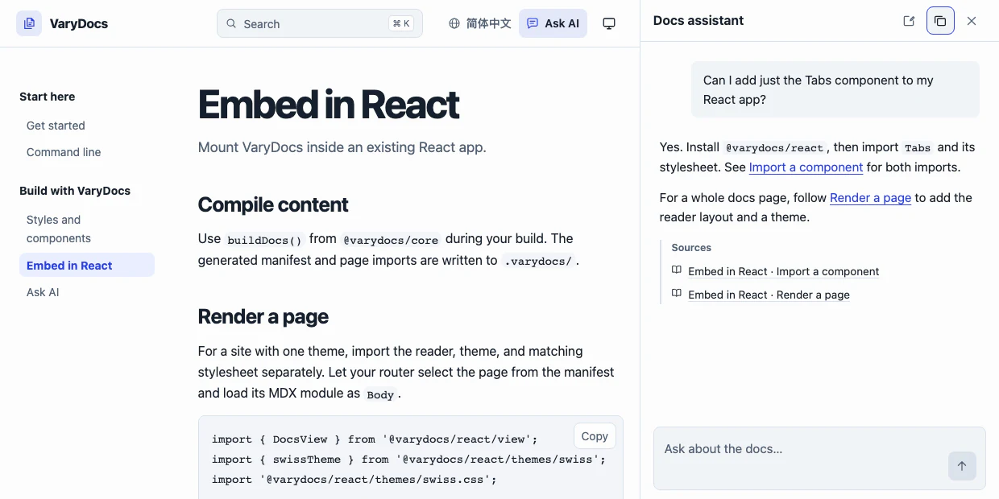

<p align="center">
  
</p>

<h1 align="center">Build documentation with React and Next.js</h1>

<p align="center">VaryDocs is an open-source toolkit for Markdown and MDX documentation. Create a site with eight themes, search, multilingual routes, and an optional AI assistant, or import individual React components into your app.</p>

<p align="center">
  <a href="#quick-start">Quick start</a> ·
  <a href="#themes">Themes</a> ·
  <a href="#building-blocks">Building blocks</a> ·
  <a href="#examples">Examples</a> ·
  <a href="README.zh-CN.md">简体中文</a>
</p>

## Quick start

Use Node.js 22.12 or later. Run these commands in the directory where you want to create your project and choose npm in the wizard.

```sh
npx @varydocs/cli@0.1.0 init my-varydocs --install
cd my-varydocs
npm run dev
```

Choose **Starter** for three linked pages with MDX examples or **Blank** for a single Markdown page. The wizard also lets you pick a theme, navigation layout, and site language. Open `/docs/` on the local URL printed by the dev server. [CLI guide](packages/core/docs/en/cli.md) · [npm package](https://www.npmjs.com/package/@varydocs/cli/v/0.1.0)

## Themes

The same CLI guide in two built-in themes. Open either screenshot to see the full-size reader.

<p align="center">
  <a href="docs/screenshots/minimal-reader.webp"></a>
  <a href="docs/screenshots/retro-desktop-reader.webp"></a>
</p>

- **Minimal** gives guides a quiet reading column, with page navigation and an outline alongside it.
- **Retro Desktop** frames documents and code as desktop windows, with a file tree and keyboard-driven search.

The CLI offers Minimal, Editorial, Terminal, Swiss, Brutalism, Blueprint, GTA6, and Retro Desktop. Generated sites bundle the selected theme and its stylesheet. Switch themes from your project directory.

```sh
npm exec -- varydocs add style desktop
```

Choose the theme's own navigation layout, a fixed top bar, or a left rail with independently scrolling navigation. Themes follow your system light or dark preference and provide a menu for a saved manual choice. [Theme and layout guide](packages/core/docs/en/styling.mdx)

## Building blocks

| Goal | Entry point |
| --- | --- |
| Create a standalone documentation site | [Interactive CLI](#quick-start) |
| Import one component into a React app | [Component and CSS imports](#import-individual-react-components) |
| Add documentation to an existing app | [Next.js App Router](#add-documentation-to-an-existing-nextjs-app) · [Vite example](examples/vite-embed/) |
| Enable questions, follow-ups, and chapter links | [AI sidebar](#add-an-ai-sidebar) |

### Import individual React components

Install `@varydocs/react` in a React 19 project, then import just the component and its stylesheet.

```sh
npm install @varydocs/react@0.1.0
```

```tsx
import { Tab, Tabs } from '@varydocs/react/components/tabs';
import '@varydocs/react/components/tabs.css';

export function BuildCommands() {
  return (
    <Tabs>
      <Tab title="npm"><code>npm run build</code></Tab>
      <Tab title="pnpm"><code>pnpm build</code></Tab>
    </Tabs>
  );
}
```

Tabs and other standalone components have no dependency on the MDX compiler. Import `appearance`, `callout`, `steps`, `code-block`, `copy-button`, and `search` from their own component paths.

For a full React reader, compile content with `@varydocs/core` and render it with `DocsView` from `@varydocs/react/view`. Import the selected theme and its CSS from `@varydocs/react/themes/<style>` and `@varydocs/react/themes/<style>.css`. The reader accepts custom component mappings and a search component. [React integration guide](packages/core/docs/en/react.md)

### Add documentation to an existing Next.js app

For a Next.js 16 App Router project with React 19, compile the content before running Next.js. Connect the page loader to a reader with the selected theme. The adapter provides static parameters and metadata for the compiled pages. [Next.js adapter](packages/next/README.md) · [Template setup](packages/cli/templates/base/lib/docs.jsx) · [Page and search routes](packages/cli/templates/base/app/)

To upgrade an older template that imports all themes, update the SDK and CLI together, then merge the current template's theme imports and reader setup into `lib/docs.jsx`.

### Add an AI sidebar

```sh
npx @varydocs/cli@0.1.0 init my-varydocs --assistant --install
```

Readers can ask about the current page, follow up across pages, and open cited sections while the conversation stays open.

<p align="center">
  <a href="docs/screenshots/docs-assistant.webp"></a>
</p>

Configure a model to stream answers through the Vercel AI SDK. The assistant can also return matching excerpts without model credentials. An existing app can integrate the sidebar and server handler through `@varydocs/ai`, which requires React 19.2.1 or later in React 19. [Setup and static-site integration](packages/core/docs/en/assistant.md)

## Write and style content

Put Markdown and MDX files in `content/docs/`. Give each page a frontmatter title, use `index.md` or `index.mdx` as the documentation home, and link to other pages by relative path with optional heading fragments. Place site images in `public/` and reference them with root-relative paths.

Set the name, navigation groups, and style in `varydocs.json`. Use built-in MDX components such as `Callout`, `Tabs`, and `Steps` with literal props. Register custom components in the host app's component map. The compiler rejects document-level imports and JavaScript expressions. [Writing guide](packages/core/docs/en/index.mdx)

### Static deployment

Run `npm run check` to validate content, links, and localized routes. Set the public origin and optional mount path when you build a static site.

```sh
VARYDOCS_SITE_URL=https://docs.example.com VARYDOCS_BASE_PATH=/product npm run build
```

Serve `out/` at the configured path and return the exported `404.html` with HTTP 404 for missing pages. An explicit origin enables canonical URLs, alternates for existing translations, and `/product/sitemap.xml`. For a site with the assistant, run `npm run build` and `npm start` on a Next.js server. A static frontend can connect to a separately hosted handler. Keep model credentials server-side.

## Internationalization

The reader and CLI ship with English and Simplified Chinese. Set the CLI UI with `--lang zh-CN`, and choose site languages separately with `--language en`, `--language zh-CN`, or `--language bilingual`.

For a multilingual project, place translations in `content/docs/<locale>/` and declare the locales in `varydocs.json`. In this example, English uses `/docs/` and Chinese uses `/zh-CN/docs/`.

```json
{
  "name": "My Docs",
  "i18n": {
    "defaultLocale": "en",
    "locales": [
      { "id": "en", "label": "English" },
      { "id": "zh-CN", "label": "简体中文" }
    ]
  }
}
```

Match source paths so the language switcher can open the same page. The site root uses the saved or browser language, while a direct documentation URL opens the language it addresses. Each locale can set its own name and navigation and gets a separate search index. Pass a messages override to `DocsView` to translate renderer labels for more languages.

### Upgrade a single-language starter

1. Update the project's VaryDocs dependencies and dev dependencies together. For a project created from source, refresh its bundled tarballs and lockfile from the same checkout.
2. Move your existing documents to `content/docs/en/` and add translations under `content/docs/zh-CN/`, including an index page. Keep each page's relative path and add the `i18n` configuration.
3. Run `npm run check` and `npm run build`, then verify both language homes and a translated page. The CLI fills in missing language routes. Merge SEO exports from the current template into any custom route that owns its metadata.

For custom top-level dynamic routes, use `[locale]` as the segment name and update the corresponding `params` references. Place custom localized home, documentation, and search routes at the matching template paths under `app/[locale]`. A page without a translation links to the target language's documentation home.

## Examples

From the repository root, use Node.js 22.12 or later and pnpm 10.

```sh
pnpm install --frozen-lockfile
pnpm dev
```

| Example | What to try |
| --- | --- |
| [Vite embedding](examples/vite-embed/) | Use `pnpm dev` to explore localized navigation, search, and a custom MDX component in a React host. `pnpm build` writes the example to `examples/vite-embed/dist/`. |
| [GTA6 reader](examples/gta6/) | Use `pnpm dev:gta6` to explore the bilingual reader, neon navigation, and illustrations included in the example content. |

### Create a documentation site from this checkout

```sh
pnpm create:local my-varydocs --lang zh-CN --template starter --style editorial \
  --language bilingual --package-manager npm --yes --install
cd my-varydocs
npm run dev
```

For the interactive wizard, run `pnpm create:local my-varydocs`. The source launcher puts the tested local packages in `vendor/varydocs/`. Keep that directory when moving the generated project.

## Package boundaries

| Package | Responsibility |
| --- | --- |
| [`@varydocs/model`](packages/model/) | Shared manifest types, search, and URL helpers with no runtime dependencies |
| [`@varydocs/core`](packages/core/) | Build-time content validation, navigation, headings, localized search data, and MDX compilation |
| [`@varydocs/react`](packages/react/) | Document reader, individual components, themes, and stylesheets |
| [`@varydocs/next`](packages/next/) | App Router integration for routes, metadata, and document rendering |
| [`@varydocs/cli`](packages/cli/) | Interactive site creation, previews, validation, and builds |
| [`@varydocs/ai`](packages/ai/) | Optional React sidebar and a server handler for document-grounded answers |

## Verify a release

Use Node.js 22.12 or later, pnpm 10, and Python 3 for the release smoke test.

```sh
pnpm test
pnpm build
pnpm pack:local
pnpm check:pack
node scripts/smoke-release.mjs
```

The smoke test builds a bilingual site under a deployment prefix and switches it through Swiss, GTA6, Retro Desktop, and Editorial. It also verifies standalone Tabs, theme assets, and bilingual assistant citations. Run `node scripts/smoke-release.mjs --registry` to repeat the checks against npm. [Release verification record](RELEASE-CHECKLIST.zh-CN.md) · [Contributor guide](CONTRIBUTING.md)

## License

VaryDocs is released under the [MIT License](LICENSE). The bundled GTA6 fonts are distributed under the SIL Open Font License. [Font notices](packages/react/styles/assets/) · [VaryDocs mark](docs/brand/varydocs-mark.svg)
