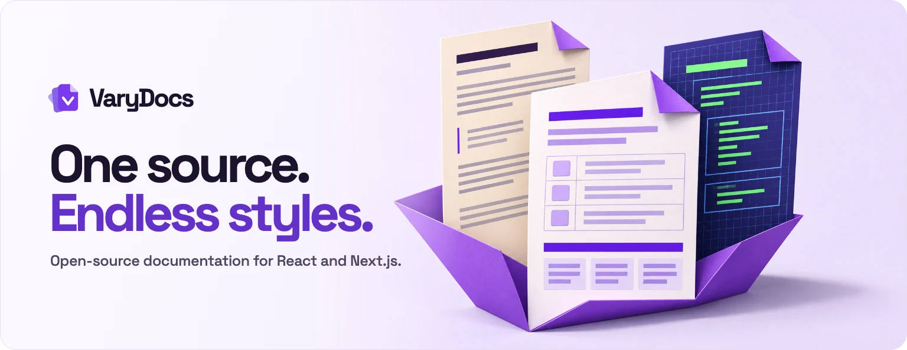
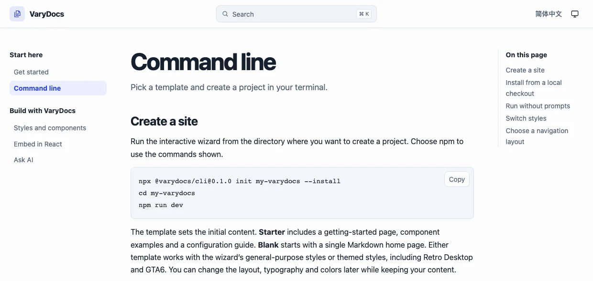
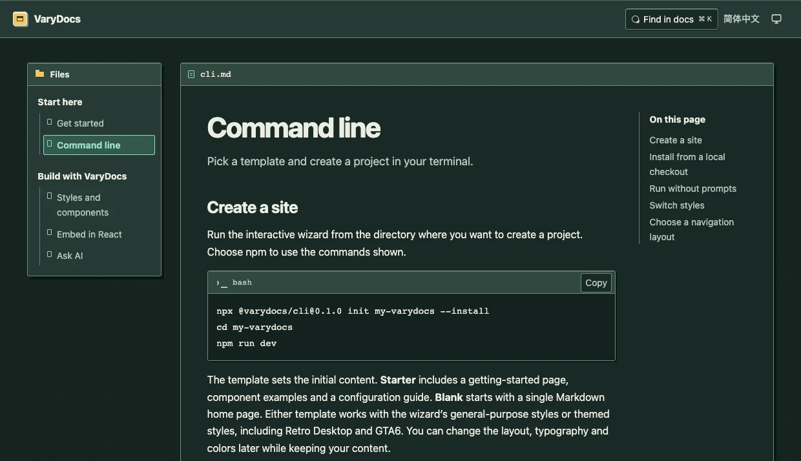
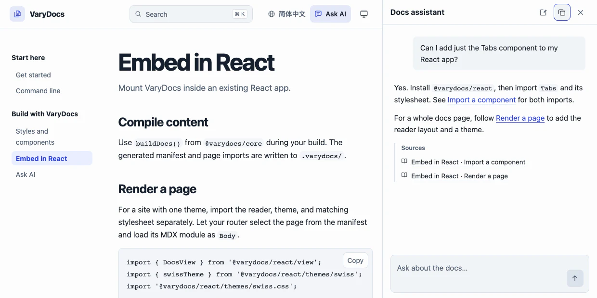

<p align="center">
  
</p>

<h1 align="center">为 React 和 Next.js 构建文档</h1>

<p align="center">VaryDocs 是一个开源文档工具包。用 Markdown 和 MDX 构建文档站，选择八种内置主题，使用搜索、多语言路由和可选 AI 助手。也可以在现有 React 应用中按需引入组件。</p>

<p align="center">
  <a href="#快速开始">快速开始</a> ·
  <a href="#主题">主题</a> ·
  <a href="#按需接入">按需接入</a> ·
  <a href="#示例">示例</a> ·
  <a href="README.md">English</a>
</p>

## 快速开始

使用 Node.js 22.12 或更高版本。在准备存放项目的目录执行以下命令，并在向导中选择 npm。

```sh
npx @varydocs/cli@0.1.1 init my-varydocs --lang zh-CN --install
cd my-varydocs
npm run dev
```

**Starter** 内置三篇相互链接的文档和 MDX 示例，**Blank** 从一页 Markdown 开始。向导还可以选择主题、导航布局和文档语言。根据开发服务器打印的本地地址打开 `/docs/`。 [CLI 指南](packages/core/docs/zh-CN/cli.md) · [npm 安装包](https://www.npmjs.com/package/@varydocs/cli/v/0.1.1)

## 主题

下面是同一篇命令行指南的两种呈现方式。点击图片可查看原尺寸截图。

<p align="center">
  <a href="docs/screenshots/minimal-reader.webp"></a>
  <a href="docs/screenshots/retro-desktop-reader.webp"></a>
</p>

- **Minimal** 用简洁的正文栏呈现指南，左右分别放置文档导航和章节目录。
- **复古桌面** 用桌面窗口呈现正文和代码，提供文件树和键盘搜索。

CLI 提供 Minimal、Editorial、Terminal、Swiss、Brutalism、Blueprint、GTA6 和复古桌面八种主题。生成项目会打包所选主题及其样式。在现有项目目录可切换主题。

```sh
npm exec -- varydocs add style desktop
```

文档可沿用主题布局，也可以使用固定顶栏或左侧独立滚动的导航栏。主题默认跟随系统明暗模式，也可以在外观菜单手动选择并保存偏好。 [主题与布局指南](packages/core/docs/zh-CN/styling.mdx)

左栏布局将站点名称和搜索固定在文档列表上方，外观、语言和已启用的 AI 助手入口位于右上角。Minimal 的桌面章节目录会随阅读保持可见，并高亮当前章节。

## 按需接入

| 想做什么 | 使用入口 |
| --- | --- |
| 创建独立文档站 | [交互式 CLI](#快速开始) |
| 给 React 应用加一个组件 | [组件和样式导入](#引入独立-react-组件) |
| 给现有应用添加文档 | [Next.js App Router](#接入现有-nextjs-应用) · [Vite 示例](examples/vite-embed/) |
| 支持提问、追问和章节跳转 | [AI 侧边栏](#添加-ai-侧边栏) |

### 引入独立 React 组件

在 React 19 项目安装 `@varydocs/react`，然后引入需要的组件和样式表。

```sh
npm install @varydocs/react@0.1.1
```

```tsx
import { Tab, Tabs } from '@varydocs/react/components/tabs';
import '@varydocs/react/components/tabs.css';

export function BuildCommands() {
  return (
    <Tabs>
      <Tab title="npm"><code>npm run build</code></Tab>
      <Tab title="pnpm"><code>pnpm build</code></Tab>
    </Tabs>
  );
}
```

Tabs 等独立组件无需安装 MDX 编译器。`appearance`、`callout`、`steps`、`code-block`、`copy-button` 和 `search` 也各有独立入口。

需要完整的 React 阅读器时，用 `@varydocs/core` 编译文档，从 `@varydocs/react/view` 导入 `DocsView`，再导入选中的主题及其 CSS。阅读器支持自定义组件映射和搜索组件。 [React 接入指南](packages/core/docs/zh-CN/react.md)

### 接入现有 Next.js 应用

在使用 React 19 的 Next.js 16 App Router 项目中，先编译内容，再把页面加载器接到所选主题的阅读器。适配器可提供页面静态参数和元数据。 [Next.js 适配器](packages/next/README.md) · [模板接入代码](packages/cli/templates/base/lib/docs.jsx) · [页面和搜索路由](packages/cli/templates/base/app/)

如果旧模板导入了所有主题，先一起更新 SDK 和 CLI，再把当前模板的主题导入和阅读器接入代码合并到自己的 `lib/docs.jsx` 中。

### 添加 AI 侧边栏

```sh
npx @varydocs/cli@0.1.1 init my-varydocs --lang zh-CN --assistant --install
```

读者可以围绕当前文档提问、跨页追问，并在会话保持打开时跳转到引用小节。

<p align="center">
  <a href="docs/screenshots/docs-assistant.webp"></a>
</p>

配置模型后由 Vercel AI SDK 流式输出，未配置模型时可查阅相关摘录。已有应用可以用 `@varydocs/ai` 接入侧边栏和服务端处理器，支持 React 19.2.1 及以上的 React 19 版本。 [模型配置与静态站接入](packages/core/docs/zh-CN/assistant.md)

## 编写文档与部署

把 Markdown 和 MDX 放在 `content/docs/`，为每页设置 frontmatter 标题，以 `index.md` 或 `index.mdx` 作为文档首页。站内文档可通过相对路径和章节锚点链接，图片放在 `public/` 并通过根相对路径引用。

在 `varydocs.json` 设置站点名称、导航和主题。MDX 支持 `Callout`、`Tabs`、`Steps` 等组件及字面量属性。自定义组件在宿主应用中注册，文档中的模块导入和 JavaScript 表达式会被编译器拒绝。 [写作指南](packages/core/docs/zh-CN/index.mdx)

### 静态部署

用 `npm run check` 校验文档、链接和多语言路由。构建静态站时设置公开域名和可选的部署前缀。

```sh
VARYDOCS_SITE_URL=https://docs.example.com VARYDOCS_BASE_PATH=/product npm run build
```

将 `out/` 部署到配置的路径，并让托管服务在页面缺失时返回导出的 `404.html` 和 HTTP 404。配置域名后，页面输出 canonical 和已有译文的 hreflang，并生成 `/product/sitemap.xml`。带 AI 助手的站点在 Next.js 服务端执行 `npm run build` 和 `npm start`。静态站也能连接独立部署的助手接口，模型密钥留在服务端。

## 国际化

阅读器和 CLI 内置英文和简体中文。用 `--lang zh-CN` 设置 CLI 界面语言，再通过 `--language en`、`--language zh-CN` 或 `--language bilingual` 独立选择站点语言。

多语言项目把译文放在 `content/docs/<locale>/`，并在 `varydocs.json` 中声明语言。下例的英文路由是 `/docs/`，中文路由是 `/zh-CN/docs/`。

```json
{
  "name": "My Docs",
  "i18n": {
    "defaultLocale": "en",
    "locales": [
      { "id": "en", "label": "English" },
      { "id": "zh-CN", "label": "简体中文" }
    ]
  }
}
```

保持各语言的源文件相对路径一致，读者就能直接切换到同一篇译文。站点根路径使用保存的语言或浏览器偏好，直接打开文档 URL 则使用该路径对应的语言。每种语言可设置独立的站点名和导航，并拥有自己的搜索索引。可通过 `DocsView` 的文案配置接入其他语言。

### 将单语 Starter 升级为双语

1. 一起升级项目的 VaryDocs 依赖和开发依赖。由源码创建的项目可从同一份源码重新打包，再更新安装包和锁文件。
2. 在 `content/docs/en/` 保留原文相对路径，在 `content/docs/zh-CN/` 添加中文首页和译文，再添加上面的 `i18n` 配置。
3. 运行 `npm run check` 和 `npm run build`，检查两种语言的首页和同路径译文。CLI 会补齐缺失的本地化路由。自定义的页面或布局可按当前模板合并 SEO 导出。

如果项目已有顶层动态路由，请将参数统一为 `[locale]` 并更新代码里的 `params` 引用。自定义语言首页、文档和搜索路由应放在 `app/[locale]` 下对应的模板路径。缺少译文时，语言切换链接会指向目标语言的文档首页。

## 示例

在源码仓库根目录使用 Node.js 22.12 或更高版本和 pnpm 10。

```sh
pnpm install --frozen-lockfile
pnpm dev
```

| 示例 | 可以体验什么 |
| --- | --- |
| [Vite 嵌入](examples/vite-embed/) | `pnpm dev` 可预览 React 宿主中的双语导航、搜索和自定义 MDX 组件。`pnpm build` 将示例构建到 `examples/vite-embed/dist/`。 |
| [GTA6 阅读器](examples/gta6/) | `pnpm dev:gta6` 可体验带霓虹色导航和文内插画的双语阅读器。 |

### 从本地源码建站

```sh
pnpm create:local my-varydocs --lang zh-CN --template starter --style editorial \
  --language bilingual --package-manager npm --yes --install
cd my-varydocs
npm run dev
```

需要交互向导时，运行 `pnpm create:local my-varydocs --lang zh-CN`。安装包会放在新项目的 `vendor/varydocs/`，移动项目时请保留该目录。

## 开源包

| 包 | 职责 |
| --- | --- |
| [`@varydocs/model`](packages/model/) | 无运行时依赖的文档清单类型、搜索与 URL 工具 |
| [`@varydocs/core`](packages/core/) | 构建时校验内容，生成导航、章节、搜索数据和 MDX 模块 |
| [`@varydocs/react`](packages/react/) | 文档阅读器、独立组件、主题和样式表 |
| [`@varydocs/next`](packages/next/) | Next.js App Router 的页面路由、元数据和渲染接入 |
| [`@varydocs/cli`](packages/cli/) | 交互式建站、预览、校验和构建 |
| [`@varydocs/ai`](packages/ai/) | 可选的 React 问答侧栏和基于文档检索的服务端处理器 |

## 发行验证

使用 Node.js 22.12 或更高版本、pnpm 10 和 Python 3 运行验证。

```sh
pnpm test
pnpm build
pnpm pack:local
pnpm check:pack
node scripts/smoke-release.mjs
```

发行测试会在部署前缀下构建双语项目，并依次切换 Swiss、GTA6、复古桌面和 Editorial，同时检查独立 Tabs、主题资源和双语助手引用。运行 `node scripts/smoke-release.mjs --registry` 可用 npm 上的安装包重新验证。 [发行验证记录](RELEASE-CHECKLIST.zh-CN.md) · [贡献与问题反馈](CONTRIBUTING.md)

## 许可证

VaryDocs 使用 [MIT 许可证](LICENSE)。GTA6 主题随附的字体使用 SIL 开放字体许可证。 [字体许可说明](packages/react/styles/assets/) · [VaryDocs 标识](docs/brand/varydocs-mark.svg)
